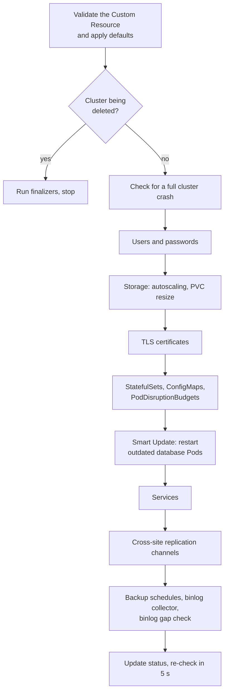
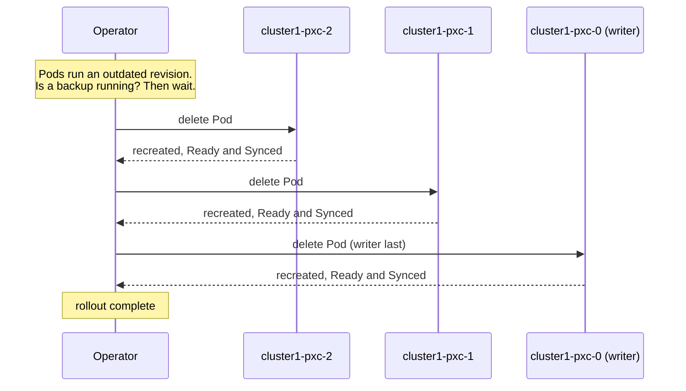

# How the Operator reacts to changes

This page explains what the Operator does after you change the Custom Resource: when it acts, in which order, which changes restart Pods, and what the cluster status tells you while the change is applied.

## What a reconcile is

The `PerconaXtraDBCluster` Custom Resource describes the *desired state* of the cluster. A *reconcile* is one pass of the Operator over the cluster: it reads the Custom Resource, compares it with the *actual state* of the Kubernetes objects and the database, and changes whatever differs. Reconciles repeat continuously, so the cluster converges to the Custom Resource even if a single pass cannot finish the job.

## What triggers a reconcile

* **A change to the Custom Resource**, or to the users Secret named in `spec.secretsName`.
* **A periodic re-check.** After each successful pass, the Operator reconciles the cluster again about 5 seconds later. Because of this, manual edits to the objects the Operator manages, such as a StatefulSet or a Service, are reverted within seconds. Make changes in the Custom Resource instead.
* **A retry after an error.** If a pass fails, the Operator retries it with an increasing delay.

!!! note "Why the Operator seems to do nothing after an error"

    After a failed pass, the Operator doesn't re-check the cluster every 5 seconds. It retries with an exponential backoff: the delay starts at a few milliseconds and doubles with each consecutive failure, up to about 16 minutes. The delay resets only after a successful pass. So if a reconcile has been failing for a while and you then fix the cause, for example create a missing Secret, the Operator may not notice it for several minutes.

    Any change to the Custom Resource starts a new pass immediately. To trigger one without changing the configuration, add or update an annotation:

    ```bash
    kubectl annotate pxc cluster1 percona.com/reconcile-trigger="$(date +%s)" --overwrite
    ```

    The annotation name is arbitrary; the Operator doesn't read it. Restarting the Operator Pod also resets the backoff.

Only one Operator Pod is active at a time; if you run several replicas, they elect a leader. The Operator watches the namespaces listed in the `WATCH_NAMESPACE` environment variable, or all namespaces if it is empty. See [Single-namespace and multi-namespace deployment](cluster-wide.md).

The `MAX_CONCURRENT_RECONCILES` environment variable of the Operator Deployment sets how many objects of each kind the Operator reconciles in parallel. It applies separately to clusters, backups and restores. The default is `1`: the Operator reconciles one cluster at a time, and other clusters wait in the queue. A pass can take long, because a [Smart Update](#how-smart-update-works) waits inside the pass for each restarted Pod. If you run many clusters with one Operator, raise this value. See [Configure concurrency for a cluster reconciliation](reconciliation-concurrency.md) and [`MAX_CONCURRENT_RECONCILES`](env-vars-operator.md#max_concurrent_reconciles).

## Order of operations

Each reconcile runs the same steps in the same order. Knowing the order helps you understand why one change waits for another: for example, a storage resize in progress delays the rest of the pass.



## What happens when I change a field

| Field | What the Operator does | Restart? |
| --- | --- | --- |
| `pxc.size`, `haproxy.size`, `proxysql.size` | Changes the number of replicas. The new size must pass the safety checks, see [Unsafe configurations](architecture-responsibilities.md#unsafe-configurations) | No |
| Image, resources, environment variables, affinity, sidecars | Updates the Pod template | Yes, a rolling restart; for database Pods in the Smart Update order |
| `pxc.configuration` | Updates the ConfigMap. The `percona.com/configuration-hash` annotation on the Pods changes | Yes |
| Contents of the TLS Secrets, the Vault Secret, or the environment variables Secret | The hash annotations on the Pods change | Yes |
| A system user password in the users Secret | Changes the password in the database, then restarts only the components that use this user. See [System users](users.md#system-users) | Yes, selectively |
| Storage size, `pxc.volumeSpec.persistentVolumeClaim.resources.requests.storage` (larger only) | Patches the PVCs and recreates the StatefulSet without deleting its Pods. Requires `storageScaling.enableVolumeScaling`. See [Scale storage](scaling.md#scale-storage) | No |
| `haproxy.enabled`, `proxysql.enabled` | Creates or deletes the proxy StatefulSet and Services. HAProxy has no PVCs. The ProxySQL PVCs are kept unless the `percona.com/delete-proxysql-pvc` finalizer is set. See [Switch the proxy](proxy-switching.md) | Proxy Pods only |
| `pause: true` | Scales all components to 0 and removes the binlog collector | Pods stop |
| `tls.enabled` | Pauses the cluster, changes the certificates, and starts the cluster again | Full stop and start |
| `upgradeOptions.apply` | On the `upgradeOptions.schedule`, checks for new versions and writes new images into the Custom Resource, which triggers a Smart Update | Yes, when a new version is applied |

## Update strategies

When a change requires restarting Pods, the `updateStrategy` option in the Custom Resource decides how it happens. See also [Update strategies](update.md#update-strategies).

* **`SmartUpdate`** (default). The Operator restarts database Pods itself, one at a time, and is aware of the client traffic: it asks the proxy which node currently receives writes and restarts that node last. With ProxySQL, it also waits until each restarted node is back in its hostgroup before it moves on. Proxy Pods use a regular Kubernetes rolling update.
* **`RollingUpdate`**. Kubernetes restarts the Pods with a native StatefulSet rolling update, without Galera awareness. It waits for each Pod to become ready, but it doesn't pause for a running backup, doesn't wait for ProxySQL to bring the node online, doesn't require a ready proxy, and doesn't stop early when a Pod can't start.
* **`OnDelete`**. Nothing restarts until you delete a Pod; Kubernetes then recreates it with the new configuration. See [Manual upgrade](update_manually.md).

### How Smart Update works



1. The Operator waits while a backup is `Starting` or `Running`. A Smart Update never restarts nodes under a running backup.
2. It asks the proxy which node is the writer. With HAProxy, it connects through the `cluster1-haproxy` Service and reads the host name of the node it lands on. With ProxySQL, it reads the writer hostgroup. Usually the writer is `cluster1-pxc-0`, but after a failover it can be another node.
3. It restarts the other nodes first, from the highest number down.
4. After each restart, it waits until the Pod is ready and its node is `Synced` with the cluster. With ProxySQL, it also waits until the node is back in its hostgroup (the writer hostgroup for `cluster1-pxc-0`, the reader hostgroup for the others) and ProxySQL marks it `ONLINE`.
5. It restarts the writer last, so writes fail over only once during the rollout.

Smart Update requires an enabled proxy (HAProxy or ProxySQL) that is ready. It stops waiting and reports a failure if a restarted Pod is in `ImagePullBackOff` or `CrashLoopBackOff`, or cannot be scheduled for more than 2 minutes. If a node does not become `Synced`, the Operator keeps waiting for up to 2 hours. While it waits, the Operator logs show what it is waiting for.

### Automatic upgrades

With `upgradeOptions.apply` set to `Recommended`, `Latest` or a specific version, the Operator checks the Percona Version Service on the `upgradeOptions.schedule` (by default, daily at 04:00) and, if a new version is available, writes the new images into the Custom Resource. The Smart Update then rolls them out. The check runs only when the cluster is `ready`. The default value `Disabled` turns automatic upgrades off. See [Automatic minor upgrades](update-automatic.md).

Upgrade the Operator itself and its CRDs before you raise `spec.crVersion`. See [Upgrade CRD and the Operator](update-operator.md).

## Status

The `status.state` field of the Custom Resource has one of these values:

| State | Meaning |
| --- | --- |
| `initializing` | The cluster is starting, a change is being applied, or at least one database or proxy Pod is not ready |
| `ready` | The cluster matches the Custom Resource and serves traffic |
| `paused` | `spec.pause` is `true` and all Pods are stopped |
| `stopping` | Pods are being stopped, for example while the cluster pauses |
| `error` | The last reconcile failed. The reason is in a condition with the reason `ErrorReconcile` and in `status.message` |

### What `ready` means

The cluster is `ready` only when all of the following are true:

* Every database Pod and every Pod of the enabled proxy has all containers ready.
* Every one of these Pods runs the current revision of its StatefulSet, so no rollout is pending.
* The cluster endpoint, `status.host`, is known. For a `LoadBalancer` Service, this means the cloud provider has assigned an address.

### Why a cluster stays in `initializing`

If the cluster stays in `initializing` for a long time, one of the conditions above is not met. A `ready` cluster also goes back to `initializing` as soon as one of its Pods becomes unready, for example after a container restart. Compare `status.pxc.ready` with `status.pxc.size`, and the same fields under `status.haproxy` or `status.proxysql`, to see which component is affected. The usual causes:

* **A rollout is pending.** Some Pods still run the previous revision, for example because a Smart Update is waiting for a backup to finish or for a node to become `Synced`. Check the Operator logs.
* **A database node isn't `Synced`.** The node is still receiving an SST, or it cannot join the cluster. Check the `pxc` container logs.
* **A PVC resize is in progress.** The cluster stays in `initializing` until the resize finishes. Check the PVC events.
* **No endpoint has been assigned.** The `LoadBalancer` Service is waiting for the cloud provider. Check `kubectl get svc`.
* **A Pod cannot be scheduled.** The status message shows the scheduler's reason.

The status does not show everything. If the state looks wrong but there is no message, read the Operator logs. See [How to tell which layer it is](architecture-responsibilities.md#how-to-tell-which-layer-it-is).

## Pause

Setting `spec.pause: true` stops the cluster gracefully:

* All database and proxy Pods are scaled down to 0. PVCs and data are kept.
* The binlog collector is removed.
* Smart Updates are not run.
* The status changes to `paused` when all Pods have stopped.

Set `spec.pause: false` to start the cluster again. The Operator also pauses the cluster itself during a restore and when you turn TLS on or off. See [Pause/resume Percona XtraDB Cluster](pause.md).
