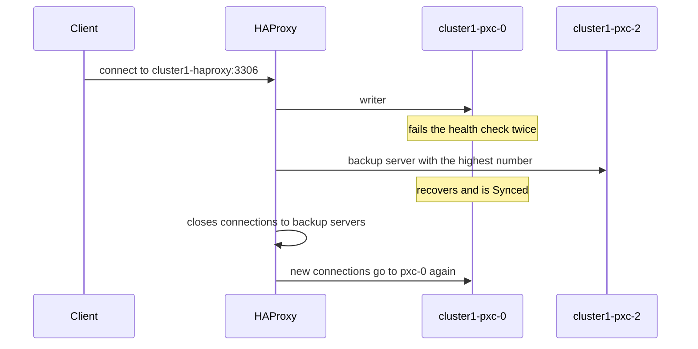
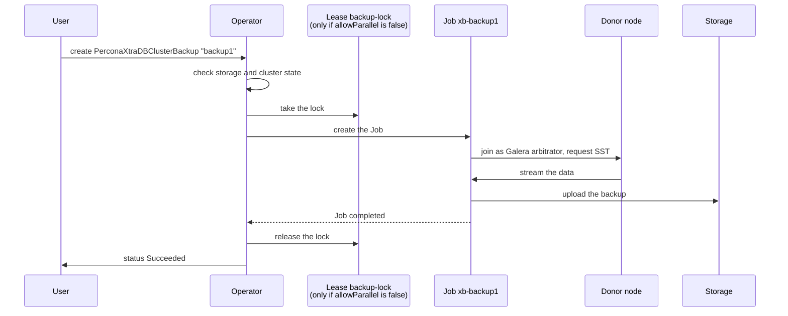
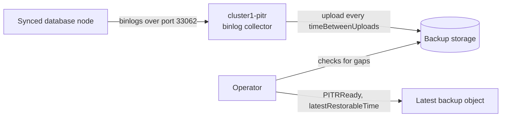
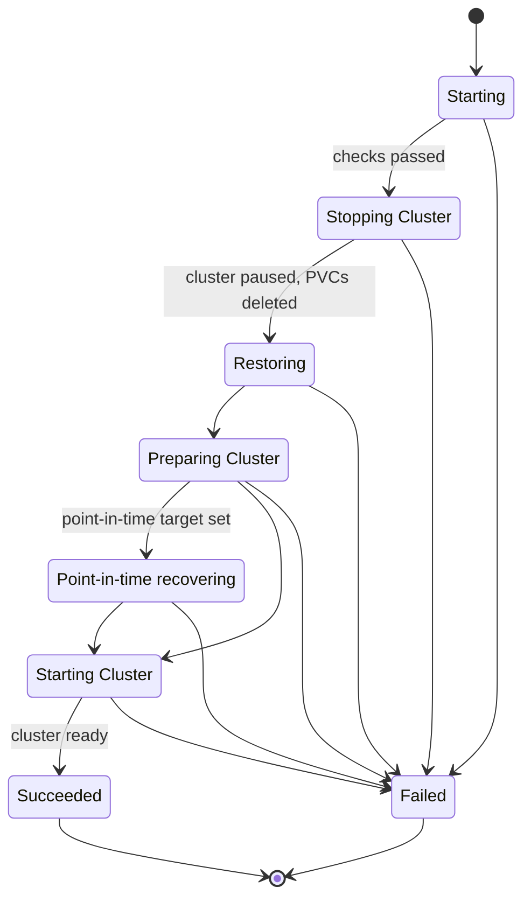
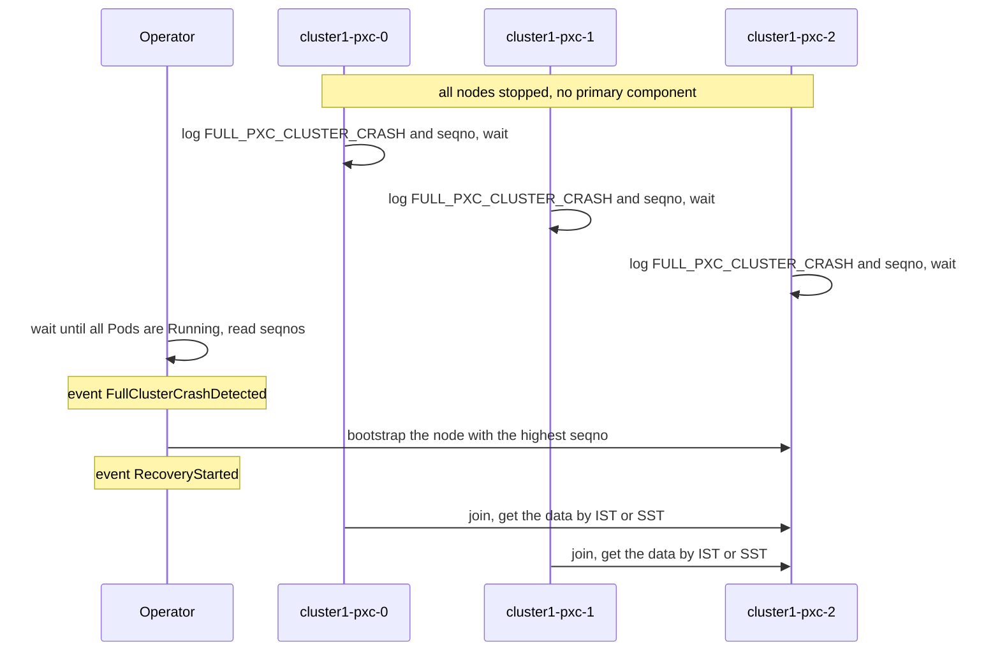

# Key workflows

This page describes the main workflows of the Operator step by step: how client traffic reaches the database and fails over, how backups, point-in-time recovery and restores work, and how the cluster recovers from a full crash. Each section ends with the objects and fields to check when the workflow fails.

The examples use a cluster named `cluster1`.

## Client traffic and proxy failover

### HAProxy

**What happens:**

* The writer is always `cluster1-pxc-0`. HAProxy chooses it by its number, not by its Galera state. The other nodes are backup servers, listed from the highest number down.
* HAProxy checks every node every 10 seconds. A node passes the check when it belongs to the primary component, is `Synced` (or a donor, when it is the only node the proxy knows about or you set `OK_IF_DONOR` to `1`), has `pxc_maint_mode` set to `DISABLED`, and accepts queries. After two failed checks in a row, the node is marked down and HAProxy closes its sessions, so a failure is noticed after 10 to 20 seconds. HAProxy doesn't mark a node down because a connection failed.
* When `cluster1-pxc-0` is down, writes go to the node with the highest number, for example `cluster1-pxc-2`.
* When `cluster1-pxc-0` passes the check again, HAProxy closes the connections to the backup server and new connections go to `cluster1-pxc-0`. Applications must reconnect.
* The `cluster1-haproxy-replicas` Service (port 3306 on the Service, 3307 in HAProxy) spreads connections across all nodes in round-robin. To exclude `cluster1-pxc-0` from reads, set [`haproxy.exposeReplicas.onlyReaders`](operator.md#haproxyexposereplicasonlyreaders).
* Port 3309 accepts connections that use the [proxy protocol](haproxy-conf.md#enabling-the-proxy-protocol).

### ProxySQL

In native mode, ProxySQL works in single-writer mode with four hostgroups: 11 for the writer, 10 for readers, 12 for backup writers, and 13 for offline nodes. The writer is `cluster1-pxc-0`, with the highest write weight (1000000, against 1000 minus the Pod number for the others) and the lowest read weight. The ProxySQL Pods form a ProxySQL cluster and share their configuration. With the external scheduler enabled, weighted writer selection prefers `cluster1-pxc-0`, and ProxySQL clustering is disabled. See [Configuring load balancing with ProxySQL](proxysql-conf.md) and [ProxySQL scheduler](proxysql-conf.md#proxysql-scheduler-tech-preview).

### Node discovery

Both proxies learn about the database nodes the same way. The `pxc-monit` container in each proxy Pod looks up the headless `cluster1-pxc` Service in DNS every second. The Service lists only ready database Pods. The first update is applied immediately. After that, updates are applied at most once every 30 seconds, so a node that leaves or joins the cluster is reflected in the proxy configuration about half a minute later.

**Where to look if it fails:**

* `kubectl get endpoints cluster1-pxc` shows which database Pods the proxies can see.
* `kubectl logs cluster1-haproxy-0 -c pxc-monit` (or `cluster1-proxysql-0`) shows the node list and configuration reloads.
* `kubectl logs cluster1-haproxy-0 -c haproxy` shows health check results.
* See also [In-cluster failover](failover-in-cluster.md) and [Configure load balancing](load-balancing.md).

## On-demand backup

**What happens:**

1. You create a `PerconaXtraDBClusterBackup` object. See [Make on-demand backup](backups-ondemand.md).
2. The Operator checks the storage configuration and waits until the cluster is `ready`. To back up a cluster that isn't `ready`, set `unsafeFlags.backupIfUnhealthy`.
3. Backups run in parallel by default. If you set [`backup.allowParallel`](operator.md#backupallowparallel) to `false`, the Operator takes the `pxc-cluster1-backup-lock` Lease, so that backups don't overlap. Other backups wait with an empty `status.state` until the lock is free. See [Multiple backups](backups.md#multiple-backups).
4. The Operator creates the Job `xb-backup1` and sets the state to `Starting`. The Job runs the Galera arbitrator (`garbd`), joins the cluster, and requests a full SST. The donor is a `Synced` node other than the writer `cluster1-pxc-0`, usually the node with the highest number. While it sends the data, the donor node is in the `Donor` state.
5. The Job streams the data to S3-compatible storage or Azure, or to a new PVC.
6. The Operator releases the lock, if it took one, and sets the backup status.

The backup goes through these states:

* Empty: the backup object exists, but the Job isn't created yet. The Operator waits for the cluster to be `ready` or, with `allowParallel: false`, for the lock.
* `Starting`: the Job is created and waits to start copying data.
* `Suspended`: the cluster became unhealthy, so the Operator suspended the Job. It resumes when the cluster is `ready` again. See [Backup suspension](backups.md#backup-suspension-for-an-unhealthy-database-cluster).
* `Running`: the Job is copying data.
* `Succeeded` or `Failed`.

`startingDeadlineSeconds` limits the time from backup object creation until the Job is created, that is, while the state is empty. It has no default, so without it a backup waits without a time limit. `runningDeadlineSeconds` limits the time from Job creation until the backup reaches `Running`. Its default is 1200 seconds. `suspendedDeadlineSeconds` limits time spent suspended. The Job's `activeDeadlineSeconds` limits its active duration. When a configured deadline is exceeded, the backup is marked `Failed`. See [Backup Custom Resource options](backup-cr.md).

When you delete a backup object, the `percona.com/delete-backup` finalizer removes the backup files from storage first.

!!! note "XtraBackup sidecar method (tech preview)"

    With the `XtrabackupSidecar` feature gate turned on, each database Pod runs an `xtrabackup` sidecar container. The backup Job asks the sidecar on a non-primary ready Pod to make the backup, and the node doesn't enter the `Donor` state. See [XtraBackup sidecar method](backups.md#xtrabackup-sidecar-method-tech-preview).

**Where to look if it fails:**

* `kubectl get pxc-backup backup1 -o yaml`: the state, and the conditions.
* `kubectl logs job/xb-backup1`: errors from the backup itself, such as wrong storage credentials or an unreachable endpoint.
* `kubectl get lease pxc-cluster1-backup-lock -o yaml`: which backup holds the lock.
* Operator logs: `Cluster is not ready for backup` means the backup waits for the cluster.

## Scheduled backups

Scheduled backups are not Kubernetes CronJobs. The Operator keeps the schedules from `backup.schedule` in its own memory and, when a run is due, creates a regular backup object named `cron-cluster1-<storage>-<timestamp>-<hash>`, where the hash is calculated from the schedule expression. From there, the backup follows the [on-demand workflow](#on-demand-backup).

* **If the cluster isn't `ready` when a run is due, the run is skipped.** No backup object and no event is created. Only the Operator log shows it, with the message `Cluster is not ready for backup. Scheduled backup is not created`.
* **The schedule runs only while the Operator runs.** No backups are created while the Operator is stopped.
* **Retention.** With `retention` set, the Operator deletes the oldest `Succeeded` backups beyond the configured count. See [Making scheduled backups](backups-scheduled.md).

**Where to look if it fails:**

* `kubectl get pxc-backup`: the `cron-*` backups and their states.
* Operator logs: skipped runs and errors creating backups.

## Point-in-time recovery

**What happens:**

* When you turn on `backup.pitr.enabled` and the cluster is `ready`, the Operator creates the `cluster1-pitr` Deployment.
* At the start of each cycle, the collector picks a `Synced` node, preferring the one with the oldest binlogs, reads its binary logs over the admin port, and uploads them to storage every `backup.pitr.timeBetweenUploads` seconds.
* The Operator checks the uploaded binlogs for gaps. A gap means some transactions are missing, for example because the servers purged binlogs before the collector uploaded them. Then the Operator sets the `PITRReady` condition of the latest backup to `False` with the reason `BinlogGapDetected`. You cannot restore to a point after the gap; take a new full backup.
* The `status.latestRestorableTime` field of the backup shows the latest point you can restore to.
* Point-in-time recovery doesn't work with backups stored on PVCs.

See [Store binary logs for point-in-time recovery](backups-pitr.md).

**Where to look if it fails:**

* `kubectl get pxc-backup <backup> -o yaml`: the `PITRReady` condition and `latestRestorableTime`.
* `kubectl logs deployment/cluster1-pitr`: collector errors, such as storage access problems.
* See [Binlog gaps](backups-restore.md#binlog-gaps).

## Restore

A restore replaces the data of the whole cluster. You start it by creating a `PerconaXtraDBClusterRestore` object. See [Restore the cluster from a previously saved backup](backups-restore.md).

**What happens:**

1. **Starting.** The Operator checks the backup, the Secrets, the storage, and the point-in-time target if you set one. Only one restore can run on a cluster at a time. The Operator repeats the basic checks on every pass, so a restore can fail in any state, for example when the cluster or the backup object is deleted while the restore runs.
2. **Stopping Cluster.** The Operator sets `spec.pause: true` on the cluster and waits until all Pods are gone. Then it deletes the PVCs of all database Pods except `datadir-cluster1-pxc-0`.
3. **Restoring.** The Job `restore-job-<restore>-cluster1` writes the backup into the data volume of `cluster1-pxc-0`.
4. **Preparing Cluster.** The Job `prepare-job-*` starts `mysqld` on the restored data, resets the system user passwords to the ones in the cluster's internal Secret, and removes the Galera state files so that the node starts a new cluster.
5. **Point-in-time recovering** (only with a `pitr` section in the restore). The Operator starts the cluster with one database node and no proxies, so clients cannot connect. The Job `pitr-job-*` replays binlogs up to the target.
6. **Starting Cluster.** The Operator restores the original sizes and unpauses the cluster. The other nodes start with empty volumes and get the data from `cluster1-pxc-0` through SST.
7. **Succeeded** when the cluster has the original sizes, the Operator has applied the latest Custom Resource generation, and the cluster is `ready`. Until then, the restore waits in **Starting Cluster**, with no time limit. **Failed** when a check fails.

!!! warning "A restore deletes data volumes and stops the cluster"

    The cluster is unavailable for the whole restore. The PVCs of all database Pods except `cluster1-pxc-0` are deleted, and the data on `cluster1-pxc-0` is overwritten. Any data written after the backup, and not covered by point-in-time recovery, is lost.

**Where to look if it fails:**

* `kubectl get pxc-restore <restore> -o yaml`: the `state` and the error in `status.comments`.
* `kubectl logs job/restore-job-<restore>-cluster1`, then the logs of the `prepare-job-*` and `pitr-job-*` Jobs, depending on the state where the restore stopped.
* Operator logs.

## Full cluster crash recovery

A full cluster crash means all database nodes stopped at the same time, for example after a power loss, so no node has a running primary component to join. See [Crash recovery](recovery.md).

**What happens:**

1. Each database Pod finds that no other node runs a primary component. It logs `FULL_PXC_CLUSTER_CRASH` and its last committed position (the `seqno`), and waits.
2. With `pxc.autoRecovery: true` (the default), the Operator waits until all database Pods are `Running`, reads their `seqno` values, and picks the node with the highest one. That node has the most recent data.
3. The Operator signals that node to bootstrap a new cluster. The other nodes join it and receive the missing data.

After it signals the node, the Operator records the recovery in the `status.recovery` field of the Custom Resource:

* `clusterUUID`: the Galera cluster UUID of the node it bootstrapped from.
* `lastRecoveryPod`: the Pod it bootstrapped from.
* `lastRecoverySeqNo`: the `seqno` of that Pod.
* `lastRecoveryTime`: when the recovery started.

On the next full crash, the Operator compares the new values with this record. It refuses automatic recovery, and emits the `AutomaticRecoveryRefused` event, if the recovery would risk data loss: if the cluster UUID differs from `clusterUUID`, or the highest `seqno` is lower than `lastRecoverySeqNo`. The event message shows both the recorded and the current values. The Operator never changes the cluster UUID itself, so this happens only after manual changes to the Galera state. See [When the Operator refuses automatic recovery](recovery.md#when-the-operator-refuses-automatic-recovery) to clean up the record.

**When you recover manually.** If `pxc.autoRecovery` is `false`, or the Operator refused automatic recovery, the nodes keep waiting. You find the node with the highest `seqno` in the `pxc` container logs and tell it to bootstrap. If the data needs repair first, you can make a node wait instead of restarting by creating a `sleep-forever` file in its data directory. The steps are in [Crash recovery](recovery.md) and [Avoid the restart-on-fail loop](debug-shell.md#avoid-the-restart-on-fail-loop-for-percona-xtradb-cluster-containers).

**Where to look if it fails:**

* `kubectl get events --sort-by=.lastTimestamp`: the `FullClusterCrashDetected`, `RecoveryStarted` and `AutomaticRecoveryRefused` events.
* `kubectl get pxc cluster1 -o jsonpath='{.status.recovery}'`: the previous recovery the Operator compares against.
* `kubectl logs cluster1-pxc-N -c pxc`: the `FULL_PXC_CLUSTER_CRASH` messages and the `seqno` of each node.
* Operator logs.

See also [Failover and high availability](failover-about.md).
