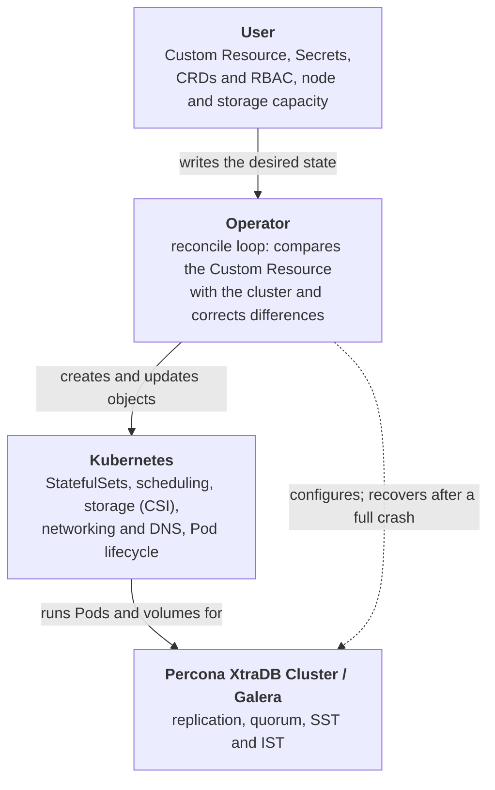
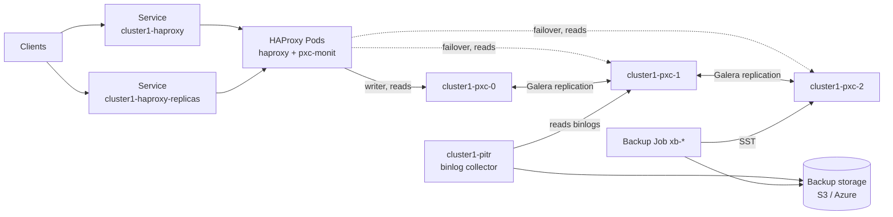

# Design and architecture

This section explains how Percona Operator for MySQL based on Percona XtraDB Cluster is built: what runs in your Kubernetes cluster, which component is responsible for what, and how the pieces interact. Read it to build a mental model of the system, and come back to it when something fails and you need to know where to look first. If something is failing now, start with [Initial troubleshooting](debug.md). The [Glossary](glossary.md) explains the Kubernetes and Galera terms used in this section.

## Percona XtraDB Cluster in brief

*Percona XtraDB Cluster* combines *Percona Server for MySQL* with the XtraDB storage engine, *Percona XtraBackup*, and the *[Galera](glossary.md#galera) library*. Galera provides virtually synchronous multi-primary replication: every node holds the full data set. A transaction commits after its write set is delivered to all nodes and passes certification. The other nodes apply it a moment later, so a read on another node can briefly return older data, unless you set the `wsrep_sync_wait` variable.

Use 3 to 5 nodes in production:

* **Not more than 5.** Every write must be confirmed by all nodes. More nodes mean more network round trips and acknowledgments for each transaction, which increases latency and resource usage.
* **An odd number.** Galera decides which nodes may keep serving queries by [quorum](glossary.md#quorum) voting. With an even number of nodes, a network partition can split the cluster into two equal halves. Neither half has a majority, so both stop serving queries to avoid data inconsistency.

With 3 nodes, the cluster keeps working when any one node goes down.

## How clients connect

Applications don't connect to the database Pods directly. A proxy sits in front of the nodes and routes client connections.

Clients connect to a Kubernetes Service that sends traffic to a proxy, and the proxy routes it to the database nodes. You choose one of two proxies:

* **HAProxy** (default) is a TCP load balancer. It sends writes to one node and can spread reads across all nodes. Applications use the `cluster1-haproxy` Service for read-write traffic and `cluster1-haproxy-replicas` for reads.
* **ProxySQL** is SQL-aware. It understands MySQL traffic and can route queries by rules. Applications use the `cluster1-proxysql` Service for both reads and writes. See [What load balancer to use?](load-balancing.md#what-load-balancer-to-use).

The Operator creates more Services for its own use, such as the [headless Services](glossary.md#headless-service) that the cluster components use to find each other. See [Services and ports](services.md) for every Service, its ports and when it exists.

## The four layers

A running cluster is the combined result of four layers. Most confusion during troubleshooting comes from expecting one layer to do something that belongs to another. The [Who owns what](architecture-responsibilities.md) page covers each layer in detail.

* **User.** You describe the cluster you want in the `PerconaXtraDBCluster` [Custom Resource (CR)](glossary.md#custom-resource) and provide everything the Operator cannot create for you: the CustomResourceDefinitions (CRDs) and RBAC, credentials for backup storage, and enough nodes and storage to run the cluster.
* **Operator.** The Operator runs a reconcile loop. It reads the CR, compares it with what exists in Kubernetes, and creates, updates or deletes objects to close the gap. It repeats this about every five seconds. It also runs day-2 tasks such as ordered restarts, password changes, backups and recovery after a full cluster crash. See [How the Operator reacts to changes](architecture-reconciliation.md).
* **Kubernetes.** Kubernetes turns the objects the Operator creates into running Pods. It schedules Pods to nodes, provisions and attaches volumes through the CSI driver, provides Services and DNS, and restarts failed containers.
* **Percona XtraDB Cluster / Galera.** Inside the Pods, Galera replicates data between nodes, maintains quorum, and brings a joining node up to date with an [Incremental State Transfer (IST)](glossary.md#ist) or a full [State Snapshot Transfer (SST)](glossary.md#sst). The Operator writes the Galera configuration but does not control these mechanisms at runtime.

## Cluster topology

The following diagram shows a cluster named `cluster1` with three Percona XtraDB Cluster nodes, HAProxy, and point-in-time recovery turned on.

Each node Pod has its own [PersistentVolumeClaim](glossary.md#pvc) (PVC) for the data directory. Galera replication runs between all node pairs; the diagram shows only two links for readability.

Here is how a client request reaches the data:

1. A client connects to the `cluster1-haproxy` Service on port 3306 for read-write traffic, or to `cluster1-haproxy-replicas` on port 3306 for reads. The replicas Service forwards port 3306 to port 3307 in the HAProxy Pods. See [Services and ports](services.md).
2. The Service forwards the connection to one of the HAProxy Pods.
3. HAProxy sends writes to `cluster1-pxc-0`. If that node fails its health check, HAProxy sends writes to another node. Read connections from the replicas Service are spread across nodes.
4. HAProxy learns which nodes exist through the headless `cluster1-pxc` Service. The `pxc-monit` container in each HAProxy Pod watches that Service in DNS and regenerates the HAProxy configuration when the set of nodes changes.
5. The node executes the transaction and Galera replicates it to the other nodes before the commit returns.

Node discovery doesn't use the Kubernetes API. A small `peer-list` tool resolves the DNS SRV records of a headless Service every second and runs a script when the list of Pods changes:

* In the proxy Pods, `pxc-monit` watches `cluster1-pxc`, which lists only ready database Pods, and updates the proxy configuration.
* In the database Pods, the `pxc` container watches `cluster1-pxc-unready`, which also lists Pods that are not ready yet, to find the other nodes when it starts and builds the Galera cluster address from them.

See [Node discovery](architecture-workflows.md#node-discovery) for the timings and where to look when it fails.

Two more components appear around the nodes:

* **The binlog collector** (`cluster1-pitr` Deployment) exists only when point-in-time recovery is turned on. It reads binary logs from one node and uploads them to backup storage. At the start of each upload cycle, it looks up the nodes through `cluster1-pxc`, keeps those that are `Synced` and in the [primary component](glossary.md#primary-component), and picks the one whose oldest binlog is the oldest. This node most likely still has every binlog the collector hasn't uploaded yet. If the current node becomes unhealthy, or another node has older binlogs, the collector switches to it and logs the reason. See [Point-in-time recovery](architecture-workflows.md#point-in-time-recovery).

* **Backup Jobs** (`xb-<backup-name>`) exist only while a backup runs. By default, the Job joins the cluster as a Galera [arbitrator](glossary.md#arbitrator) and receives a full copy of the data from a [donor](glossary.md#donor) node through SST, then uploads it to storage. With the `XtrabackupSidecar` [feature gate](env-vars-operator.md#pxco_feature_gates) turned on (a tech preview feature), each database Pod runs an extra `xtrabackup` container instead. The backup Job asks this sidecar on a non-primary node to run XtraBackup on the local data, so no node enters the `Donor` state. See [Backup methods](backups-methods.md).

If you use ProxySQL instead of HAProxy, the picture is the same with `cluster1-proxysql` in place of `cluster1-haproxy`. There is no separate replicas Service, because ProxySQL splits reads and writes by its own rules. See [Services and ports](services.md).

With `proxysql.scheduler.enabled`, ProxySQL uses the external [`pxc_scheduler_handler` :octicons-link-external-16:](https://docs.percona.com/proxysql/psh-overview.html) instead of its built-in Galera support. The scheduler checks the nodes, keeps exactly one writer, and spreads `SELECT` queries across all nodes, or across all nodes except the writer when `proxysql.scheduler.writerIsAlsoReader` is `false`. With the scheduler enabled, the ProxySQL instances no longer form a ProxySQL cluster, and the `proxysql-monit` container is not created. See [ProxySQL scheduler](proxysql-conf.md#proxysql-scheduler-tech-preview).

The [Key workflows](architecture-workflows.md) page describes proxy failover, backups, restores and crash recovery step by step.

### Scheduling and storage

To survive a node failure, the Operator places the database Pods on separate Kubernetes nodes with [Pod anti-affinity :octicons-link-external-16:](https://kubernetes.io/docs/concepts/scheduling-eviction/assign-pod-node/#affinity-and-anti-affinity). By default, this rule is *required*: with three database Pods you need at least three schedulable nodes, or a Pod stays `Pending`. See [Control Pod scheduling](constraints.md) to change it.

If a Kubernetes node fails, Kubernetes can recreate the Pod on another node, but for a [StatefulSet](glossary.md#statefulset) Pod it does so only after the failed Node object is removed or the stuck Pod is force-deleted. The Operator does neither. The Pod's data lives in a PersistentVolume, so the storage must be able to follow the Pod: the Container Storage Interface (CSI) driver and StorageClass must support attaching the volume on a different node. A volume that can attach only in one zone keeps the Pod in that zone.

## What gets created

For a cluster named `cluster1`, the Operator creates StatefulSets for the database and the proxy, Services, Secrets, ConfigMaps, [PodDisruptionBudgets](glossary.md#pdb) and PersistentVolumeClaims. Jobs and the binlog collector exist only while a backup, a restore or point-in-time recovery needs them. PVCs and Secrets are not owned by the Custom Resource, so deleting the cluster doesn't delete them.

* [Services and ports](services.md) lists every Service, its ports, and when it exists.
* [Objects the Operator creates](objects-created.md) lists all other objects, the [finalizers](glossary.md#finalizer) that clean them up, and the containers in each Pod.

## Next steps

[Who owns what](architecture-responsibilities.md){.md-button}
## See also

* [Services and ports](services.md)
* [Objects the Operator creates](objects-created.md)
* [Glossary](glossary.md)
* [Comparison with other solutions](compare.md)
